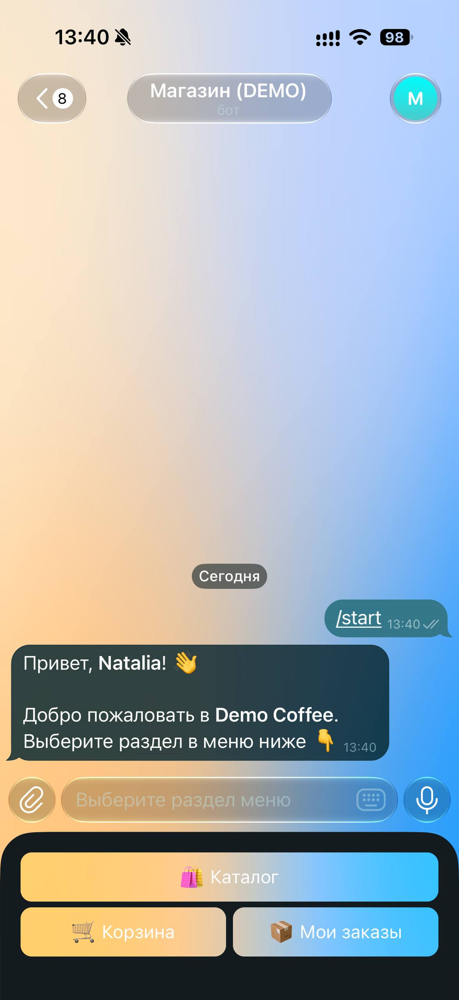
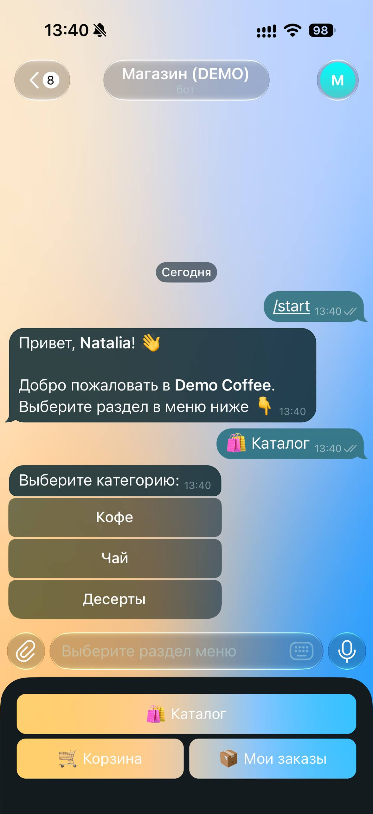
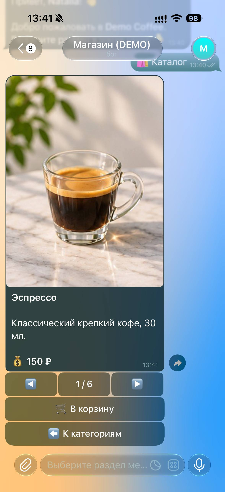
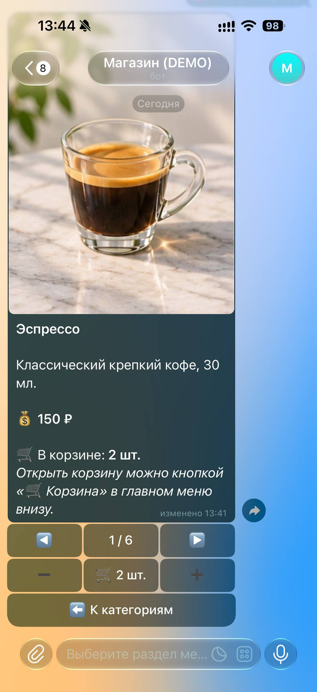
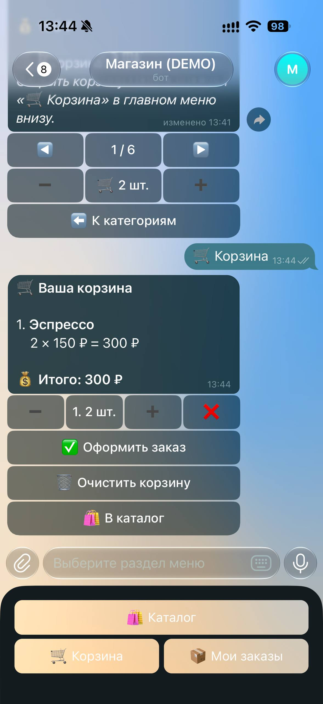
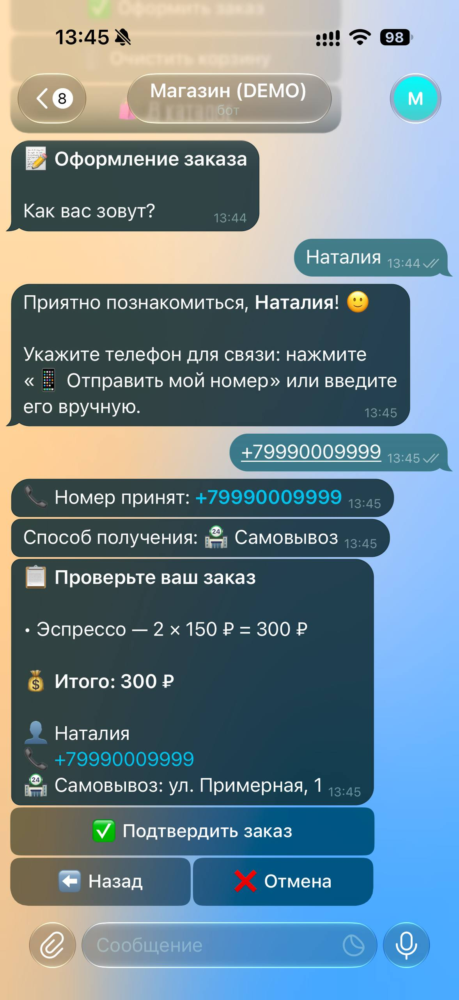
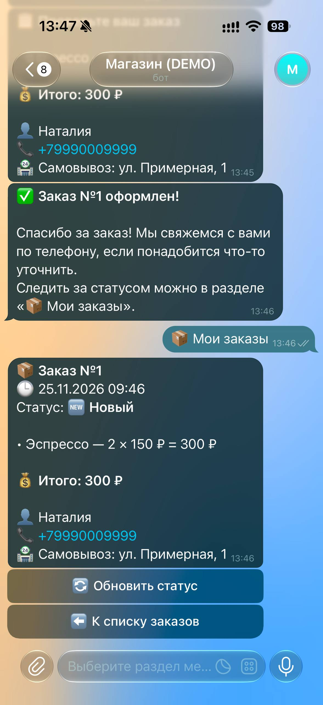
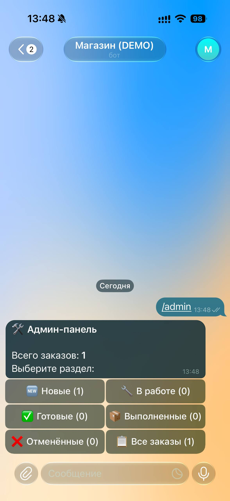
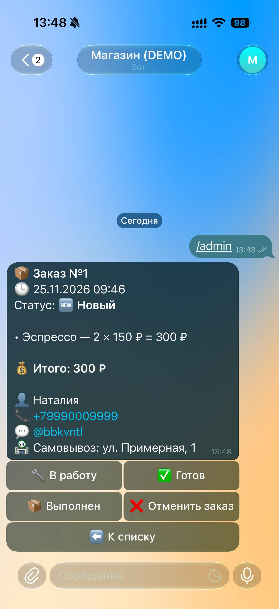
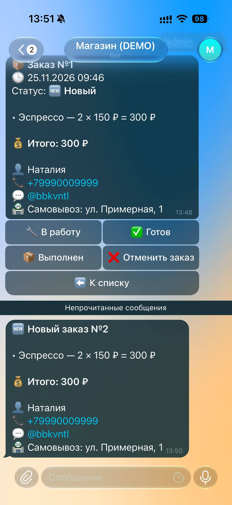

🛍 Telegram-бот: интернет-магазин


Готовый Telegram-бот для небольшого магазина или кофейни: каталог с фото, корзина, оформление заказа и админ-панель для владельца. Заказы приходят владельцу в Telegram, а клиент получает уведомления о смене статуса.


Демо: @shop\_demo\_1\_bot (https://t.me/shop\_demo\_1\_bot) \(бот работает, пока он запущен у автора)


Python (https://img.shields.io/badge/Python-3.10+-blue)

aiogram (https://img.shields.io/badge/aiogram-3.x-2CA5E0)

SQLite (https://img.shields.io/badge/SQLite-aiosqlite-003B57)


 ✨ Возможности


Для клиента

\- Главное меню и каталог по категориям

\- Карточки товаров с фото, листание по кругу

\- Изменение количества прямо на карточке (➖ / ➕)

\- Корзина: изменить количество, убрать товар, очистить, итоговая сумма

\- Оформление заказа: имя → телефон → доставка или самовывоз → адрес → подтверждение

\- Кнопки «Назад» и «Отмена» на каждом шаге оформления

\- Проверка и приведение к единому виду номера телефона

\- «Мои заказы» со статусами и составом заказа


Для владельца

\- Мгновенное уведомление о новом заказе (состав, сумма, контакты клиента)

\- Админ-панель `/admin`, доступная только владельцу (по `ADMIN\_ID`)

\- Счётчики заказов по статусам, списки с постраничным листанием

\- Смена статуса заказа с автоматическим уведомлением клиента

\- Защита от ошибок: отменённый заказ изменить нельзя, даже со старых карточек


📸 Скриншоты


| Меню | Каталог | Карточка |

|:---:|:---:|:---:|

|  |  |  |


| Количество на карточке | Корзина | Оформление |

|:---:|:---:|:---:|

|  |  |  |


| Мои заказы | Админ-панель | Заказ в админке |

|:---:|:---:|:---:|

|  |  |  |


| Уведомление владельцу |

|:---:|

|  |


🧰 Технологии


\- Python 3.10+

\- \[aiogram 3](https://docs.aiogram.dev/): роутеры, FSM (машина состояний), типизированный `CallbackData`

\- SQLite + aiosqlite (асинхронная работа с базой)

\- python-dotenv: токен и настройки хранятся в `.env`, а не в коде


🚀 Быстрый старт


1. Создайте бота у @BotFather (https://t.me/BotFather) командой `/newbot` и сохраните токен. Свой Telegram ID можно узнать у @userinfobot (https://t.me/userinfobot).


2. Скачайте проект и установите зависимости:


```

git clone https://github.com/ВАШ\_НИК/telegram-shop-bot.git

cd telegram-shop-bot

python -m venv venv

venv\\Scripts\\activate          # Windows

\# source venv/bin/activate     # Linux / macOS

pip install -r requirements.txt

```


3. Создайте файл `.env` на основе шаблона и заполните его:


```

copy .env.example .env         # Windows

\# cp .env.example .env         # Linux / macOS

```


4. Запустите бота:


```

python main.py

```


При первом запуске база данных создаётся автоматически и заполняется демо-каталогом. Затем отправьте боту `/start`. Перед этим нажмите «Старт» у бота с аккаунта владельца, иначе бот не сможет написать ему первым.


⚙️ Настройки (`.env`)


| Переменная | Описание |

|---|---|

| `BOT\_TOKEN` | токен бота от @BotFather (обязательно) |

| `ADMIN\_ID` | Telegram ID владельца: получает заказы и доступ к `/admin` (обязательно) |

| `DB\_PATH` | путь к файлу базы данных, по умолчанию `database/shop.db` |

| `SHOP\_NAME` | название магазина в приветствии |

| `PICKUP\_ADDRESS` | адрес самовывоза, который видит клиент |

| `TIMEZONE\_OFFSET` | сдвиг времени от UTC в часах (3 = Москва) |


🛠 Как заменить каталог на свой


\- **Товары и категории.** Демо-данные лежат в `database/db.py` (списки `DEMO\_CATEGORIES` и `DEMO\_PRODUCTS`). Они добавляются только в пустую базу. Чтобы применить изменения, остановите бота, удалите `database/shop.db` и запустите снова.

\- **Фото.** Кладите файлы в `media/products/` с номером товара в имени: `1.jpg`, `2.jpg`, … Номер соответствует порядку товаров в `DEMO\_PRODUCTS`. Для товаров без фото карточка показывается без картинки.


📦 Статусы заказа


| Статус | Значение |

|---|---|

| 🆕 Новый | заказ только что оформлен |

| 🔧 В работе | заказ принят и готовится |

| ✅ Готов | можно забирать или заказ передан в доставку |

| 📦 Выполнен | заказ получен клиентом |

| ❌ Отменён | заказ отменён (дальнейшие изменения невозможны) |


🗂 Структура проекта


```

├── main.py              # точка входа

├── config.py            # настройки из .env

├── utils.py             # форматирование цен, дат, телефона, поиск фото

├── database/            # работа с SQLite: каталог, корзина, заказы

├── handlers/            # обработчики: каталог, корзина, оформление, заказы, админка

├── keyboards/           # кнопки и меню

├── media/products/      # фото товаров

├── docs/screenshots/    # скриншоты для README

├── requirements.txt

└── .env.example         # шаблон настроек

```


📝 Заметки


\- Название и цена товаров копируются в заказ в момент оформления, поэтому старые заказы не меняются, если товар подорожает или будет удалён.

\- Фото кэшируются по `file\_id` Telegram: при повторном показе они отправляются мгновенно.

\- Секреты (`.env`) и база данных исключены из репозитория через `.gitignore`.

\- Фото товаров: ИИ изображения.


📬 Нужен такой бот?


Делаю Telegram-ботов на заказ: магазины, запись клиентов, уведомления, админ-панели.

Пишите в Telegram: @ntlbbkv (https://t.me/ntlbbkv) 

